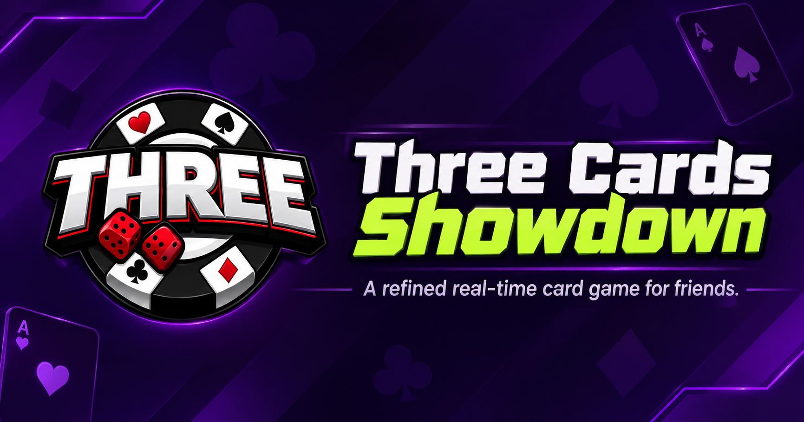

# Three Cards Showdown

<p align="center">


</p>
<p align="center">
A real-time multiplayer card game you can play in your browser with
friends.
</p>
<p align="center">
<a href="https://three-card.onrender.com/"><strong>▶Play Now</strong></a>
</p>
## About the game

**Three Cards Showdown** is a browser-based multiplayer card game built
for quick, social matches. Create or join a game room, invite friends,
and play together in real time.

## Tech stack

-   **Node.js** --- server runtime
-   **Express.js** --- serves the application and handles HTTP routes
-   **Socket.IO** --- real-time communication between players

## Play

Visit **[three-card.onrender.com](https://three-card.onrender.com/)** to
start playing.

## Run locally

1.  Clone this repository.

2.  Install dependencies:

    ``` bash
    npm install
    ```

3.  Start the server using the script configured in `package.json`, for
    example:

    ``` bash
    npm start
    ```

4.  Open the local URL printed by the server in your browser.

> The game server must be running for multiplayer features to work.

## Project

This repository contains the game and its web interface. The landing
page can also be deployed separately as a static site, with its **Play
Now** link pointing to the live game server.
